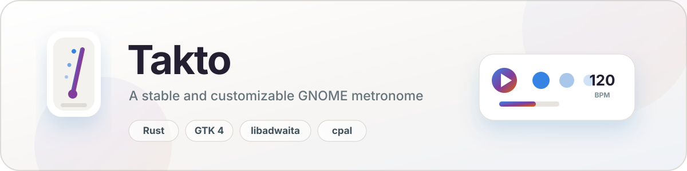

<div align="center">
  <picture>
    <source media="(prefers-color-scheme: dark)" srcset="assets/brand/banner-dark.svg">
    
  </picture>

  <p>
    
    
    
    
    
  </p>

  <p>
    <strong>Precise rhythm.</strong> Custom click sounds. Native GNOME experience.<br>
    Metrognome keeps timing in the audio callback, not in a GUI timer.
  </p>
</div>

## Highlights

| | |
|---|---|
| 🎯 **Sample-clock scheduling** | Beats are planned in audio samples, with a continuous `cpal` output stream. |
| 🎚 **20–300 BPM** | Continuous tempo changes and tap tempo without losing the beat. |
| 🥁 **Clickable accents** | 2/4, 3/4, 4/4, and 6/8 patterns; tap a beat to customize accents. |
| 🔊 **Built-in sounds** | Classic, Woodblock, Digital, and Soft presets. |
| 🎛 **Your sounds** | Import 16-bit PCM or floating-point WAV files; Metrognome downmixes, resamples, and normalizes them. |
| 🖤 **libadwaita UI** | Native GNOME controls with light and dark theme support. |
| 💾 **Reliable settings** | Settings persist through atomic temporary-file writes. |

## Quick start

Install the GTK development dependencies on Debian or Ubuntu:

```sh
./scripts/install-deps.sh
```

Build and run the desktop UI:

```sh
cargo run --features ui
```

Run the audio-core tests:

```sh
cargo test
```

CLI smoke tests are useful without a desktop session:

```sh
cargo run -- --preset woodblock
cargo run -- --normal ./normal.wav --accent ./accent.wav
```

On GNOME or Wayland, launch the application from the desktop session rather than a plain SSH environment.

## How it works

The GUI only changes parameters and displays state. The audio callback owns the sample clock:

```text
GTK UI
  → BPM, pattern, volume, sound
  → audio engine

Audio callback
  → exact next-hit position in samples
  → mixes the click into the output buffer
  → publishes beat events to the UI
```

This avoids drift and accumulated timing error, including at high tempos.

## Audio assets

The Classic preset uses embedded CC0 1.0 OGG Vorbis samples from
Kenney “Interface Sounds”. Details are in
[`assets/audio/LICENSE.md`](assets/audio/LICENSE.md).

## Status

Metrognome is an active work-in-progress application. The audio scheduler,
accent patterns, sound presets, WAV import, UI controls, settings persistence,
and core scheduling tests are implemented.

## License

Released under the MIT License.
