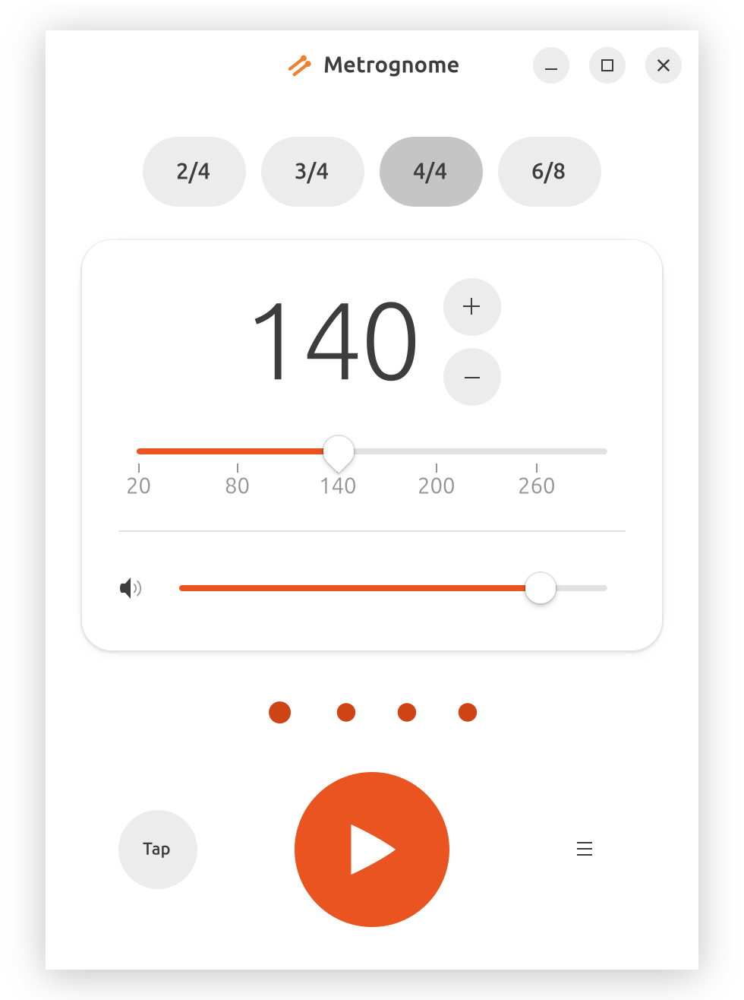

<div align="center">
  

<p align="center">
  <a href="../../README.md" title="English"></a>
  <a href="README.zh-CN.md" title="中文"></a>
  <a href="README.hi.md" title="हिन्दी"></a>
  <a href="README.es.md" title="Español"></a>
  <a href="README.fr.md" title="Français"></a>
  <a href="README.ar.md" title="العربية"></a>
  <a href="README.bn.md" title="বাংলা"></a>
  <a href="README.pt.md" title="Português"></a>
  <a href="README.ru.md" title="Русский"></a>
  <a href="README.ur.md" title="اردو"></a>
  <a href="README.de.md" title="Deutsch"></a>
  <a href="README.ja.md" title="日本語"></a>
  <a href="README.pa.md" title="ਪੰਜਾਬੀ"></a>
  
  <a href="README.te.md" title="తెలుగు"></a>
  <a href="README.tr.md" title="Türkçe"></a>
  <a href="README.ko.md" title="한국어"></a>
  <a href="README.vi.md" title="Tiếng Việt"></a>
  <a href="README.it.md" title="Italiano"></a>
  <a href="README.id.md" title="Bahasa Indonesia"></a>
  <a href="README.pl.md" title="Polski"></a>
  <a href="README.uk.md" title="Українська"></a>
  <a href="README.nl.md" title="Nederlands"></a>
  <a href="README.th.md" title="ไทย"></a>
  <a href="README.sw.md" title="Kiswahili"></a>
</p>

  <p>
    
    
    
    
    
  </p>

  <p>
    <strong>मेट्रोनोम.</strong> अचूक लय आणि समृद्ध आवाज़ संच. <br>नेटिव GNOME इंटरफेस.
  </p>
  <p>
    
  </p>
</div>

## मुख्य वैशिष्ट्ये

- 🎚 **20–300 BPM** — सहज टेम्पो बदल आणि टॅप टेम्पो.
- 🥁 **सानुकूलित करण्यायोग्य तालमात्रा** — 2/4, 3/4, 4/4 आणि 6/8 तालमात्रा समर्थित आहेत.
- 🎯 **बीट म्यूट करणे** — कोणत्याही बीटचा आवाज़ बंद करता येतो.
- 🔊 **19 अंतर्भूत सॅम्पल.**

## नियोजित
- 🎛 **तुमचे आवाज़** — 16-बिट PCM किंवा फ्लोटिंग-पॉइंट WAV आयात करा; Metrognome डाउनमिक्स, रीसॅम्पल आणि नॉर्मलायझेशन करतो.

## डाउनलोड

नवीनतम रिलीज [GitHub Releases](https://github.com/ez404-36/metrognome/releases/latest) वर उपलब्ध आहे.

| आर्टिफॅक्ट | डाउनलोड |
|---|---|
| Debian पॅकेज (x86_64) | [डाउनलोड](https://github.com/ez404-36/metrognome/releases/latest) |
| पोर्टेबल AppImage (x86_64) | [डाउनलोड](https://github.com/ez404-36/metrognome/releases/latest) |
| SHA-256 चेकसम | [डाउनलोड](https://github.com/ez404-36/metrognome/releases/latest) |

विकास आणि बिल्ड सूचना [DEVELOP.md](../../DEVELOP.md) मध्ये आहेत. सर्व रिलीज [GitHub Releases](https://github.com/ez404-36/metrognome/releases/latest) येथे पहा.

## हे कसे कार्य करते

GUI फक्त पॅरामीटर्स बदलते आणि स्थिती दाखवते. ऑडिओ कॉलबॅक सॅम्पल क्लॉकचा मालक असतो:

```text
GTK UI
  → BPM, pattern, volume, sound
  → audio engine

Audio callback
  → exact next-hit position in samples
  → mixes the click into the output buffer
  → publishes beat events to the UI
```

यामुळे जास्त टेम्पोवरही ड्रिफ्ट आणि साठलेली काल त्रुटी टाळता येते.

## ऑडिओ संसाधने

Classic प्रीसेट Kenney “Interface Sounds” मधील एम्बेडेड CC0 1.0 OGG Vorbis सॅम्पल वापरतो. तपशील [`assets/audio/LICENSE.md`](../../assets/audio/LICENSE.md) मध्ये आहेत.

## परवाना

MIT परवान्याअंतर्गत प्रकाशित.
